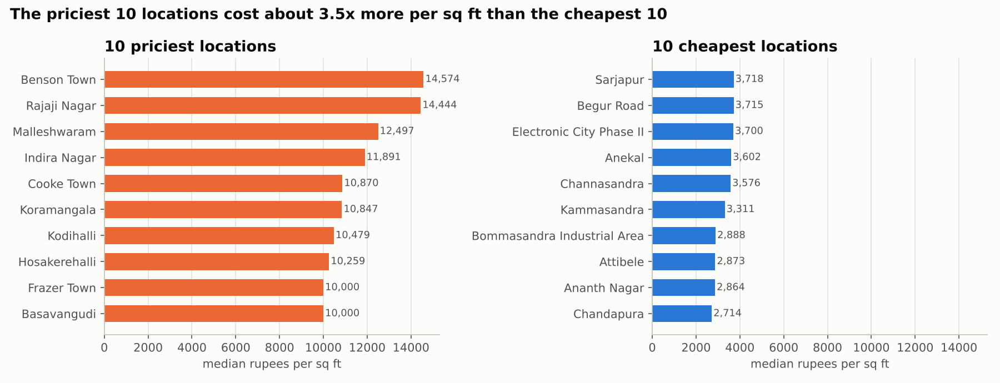

# Bengaluru House Price Analysis

End-to-end data analysis of 13,320 Bengaluru house listings: cleaning, feature engineering, outlier handling, EDA, statistics, NumPy/maths, SQL, and preparation for machine learning.

**Notebook:** `bengaluru_house_price_analysis.ipynb` (HTML copy with outputs: `bengaluru_house_price_analysis.html`)

## Key findings

| Finding | Evidence |
|---|---|
| 13,320 raw rows became 10,018 usable rows (75%) after fixing units, ranges, duplicates and impossible values | cleaning + outlier logs |
| Typical home: about 70 lakh (median); mean 106 lakh because of a long right tail (skew 8.2) | histograms |
| Location changes the rate enormously: priciest locations ~12,500-14,600 per sq ft, cheapest ~2,700-2,900 | EDA 6.3 |
| Plots have the highest median rate (8,005 vs 5,189 for Built-up); area-type differences are statistically significant | ANOVA / Kruskal |
| Size is the biggest numeric driver: a line on sq ft explains 57% of price variation (+10.8 lakh per 100 sq ft) | section 7.6 |
| Ready-to-move vs not: tiny effect (Cohen's d = 0.16) despite a small p-value | Welch t-test |
| Baseline-beating preview model on unseen data: MAE 33 vs 67 lakh, R2 0.63 | section 11.7 |



## What the notebook covers

Python, pandas cleaning, feature engineering (ratios, flags, 4 encodings), outliers (domain rule, z-score, IQR, per-group), EDA with matplotlib/seaborn, statistics (skew, CLT, confidence intervals, bootstrap, t-test, ANOVA, chi-square, effect size), NumPy (vectorising, broadcasting), maths for ML (vectors, cosine similarity, derivative, gradient descent, normal equation), SQL (SELECT, GROUP BY, CTE, window functions, JOIN, view, index), and pre-ML prep (leakage, split first, fit on train only, one-hot, scaling, baseline).

## Run it

```bash
python -m venv .venv && source .venv/bin/activate   # Windows: .venv\Scripts\activate
pip install -r requirements.txt
jupyter notebook bengaluru_house_price_analysis.ipynb
pytest                                               # tests for the cleaning functions
```

## Project layout

```
bengaluru_house_price_analysis.ipynb   main notebook
data/Bengaluru_House_Data.csv          raw data (unchanged)
data/processed/                        cleaned + model-ready train/test CSVs
figures/                               every chart as PNG
src/cleaning.py, tests/                reusable cleaning functions + pytest tests
```

## Limits

Asking prices (not final sale prices), no dates, cleaning rules also drop some real unusual homes, and correlation is not causation.

Data: public "Bengaluru House Price Data" (Kaggle / Codebasics copy).
